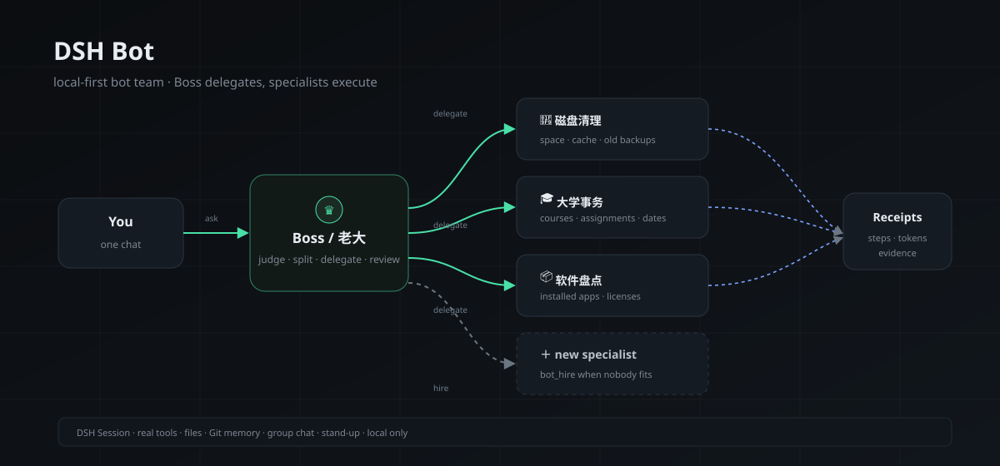

# DSH Bot

[](https://github.com/wuuu854-boop/dsh-bot/actions/workflows/checks.yml)
[](LICENSE)

> 一个跑在 DeepSeek Harness 里的本地 Bot 团队：你只跟「老大」说话，它负责判断、拆活、派活、验收和汇报。



## 它是什么

DSH Bot 不是聊天壳，而是把一台 Windows 电脑上的真实工作拆给一组各有专长的 Bot：

- 每个 Bot 都有自己的 DSH Session、工作区、长期记忆和模型配置；
- 「老大」接收你的需求，能自己做就做，做不了就派给对口成员；
- 成员干完自动回执，老大验收后向你汇报；
- 需要新工种时，老大可以现场创建一个新 Bot 并立即派活；
- 每天早上，全员在晨会群里汇报最近的工作，老大出纪要。

所有执行都发生在你本机；没有云端账号，也没有隐藏上传。

## 核心能力

### 老大 + 专家团队

- **Boss/lead**：唯一需要你对话的 Bot；`bot_delegate` 派活，回执自动回到它。
- **专家/member**：按自己的需要添加，例如磁盘清理、大学事务、软件盘点；每个都有 workspace、memory、persona、权限和模型。
- **自建员工**：没有对口成员时，Boss 用 `bot_hire` 创建新 Bot（角色、头像、persona、workspace、模型）并立即派活。
- **派活可观测**：卡片显示状态、步数、耗时、tokens；失败/中断可一键重试，最多 3 次。
- **主题切换**：顶栏三色圆点，暗色 / 暖色 / 水墨；三种主题的对话气泡、输入区和标题字体各自不同，刷新后保持。
- **本地记忆检索**：`memory_search.py search --query "关键词"` 搜长期记忆、旧任务标题和群聊记录；中文按子串匹配，不上传、不依赖向量库。
- **本地隔离工作台**：没有云电脑也能隔离实验——Windows Sandbox 可用时开一次性桌面，否则用独立浏览器 profile + 独立工作区；日常 Cookie 和下载不受影响。
- **OCR 兜底**：canvas/PDF/图片题用 `computer.py window-shot` + `ocr.py` 本地 Tesseract，不默认全屏截图；中文需安装 chi_sim 语言包。
- **深度调研/电脑体检/隔离工作台模板**：从输入框旁模板直接套用，不需要记命令。
- **命令中心**：`Ctrl+K` 打开，快速新建任务、添加专家、打开记忆/指引/主题，并全局搜索消息、任务标题和所有 Bot 记忆。
- **任务难度**：发送前可选「简单 / 标准 / 困难」；简单/标准用 `high`，困难用 `max`，并显示在标题栏和任务列表里。
- **多主题**：暗色、暖色、水墨、极光、余烬五套风格，顶部色点即时切换并记住选择。
- **新手引导**：首次打开自动显示 4 步指引（怎么交代、专家按需添加、模板/记忆/语音、浏览器与授权行为）；侧边栏「使用指引」可随时重看。
- **语义控件优先**：`computer.py windows` 看窗口/进程/DPI，`uia.py list/click/type` 按无障碍控件操作；截图和坐标只用于 canvas/PDF/图片按钮；UIA 的 2x 坐标会自动归一化。
- **窗口级截图/剪贴板/启动**：`window-shot` 只截目标窗口，`clipboard get/set`、`launch`、`wait-window` 不截全屏。
- **智慧职教 / 刷课适配**：`course.py status` 判断视频/PPT/题目/下一回合，`play` 播放、`ppt` 翻页、`question` 读题、`answer` 作答、`next` 进入下一回合；每次点击验证是否变化，无变化禁止循环。
- **失败可处理**：任务失败会显示“这次没做成”，给出已尝试步骤，并提供重试、换办法、复制诊断，不用重开对话。
- **权限确认**：新 Bot 默认标准权限；标准模式下敏感操作走 DSH 授权弹窗，切换到管理员必须勾选风险确认，输入区会持续显示“管理员权限”标记。
- **语音输入**：麦克风按钮调用 Windows 系统听写（Win+H），说完再点一次结束；不依赖浏览器语音 API。
- **进度透明**：运行中显示“正在读取网页 / 检查磁盘 / 派活给谁”等中文动作和最近完成步骤；技术代码默认折叠。
- **对话回放**：顶栏「回放」按时间线重播当前对话，支持播放/暂停、进度拖动；长任务可以像看录像一样复盘。
- **任务模板**：输入框「模板」提供网页作业、网页速读、磁盘清理、今日复盘四套提示词，点一下填入再补 URL/细节。
- **健康检查**：`GET /health` 返回版本、运行时长、状态大小、模型状态和最近错误；`GET /doctor` 逐项检查 Python / Edge / 模型 / 磁盘 / 状态目录。
- **版本提醒**：后台每 6 小时检查 GitHub Release；有新版时聊天页顶部提示下载，可“稍后提醒”。
- **群内派活**：Boss 在群里用 `bot_dispatch`，同样会生成 assignment 并回收执。

### 群聊

- 2–8 个 Bot 在同一个群聊，`@名字` 点名，未点名时按群规则路由；
- 成员回复按发言人归位，支持引用、跳转原消息、多条置顶、收藏夹；
- 会话内搜索 / 跨会话搜索，命中词高亮，点击跳转；
- 历史消息分页加载；当前会话可导出 Markdown。

### 每日晨会

- 当天第一次打开 DSH 时自动开晨会；
- 每位成员基于最近 36 小时的真实 run 记录汇报，Boss 出纪要；
- 可配置：关闭、只在工作日、只在有工作时开；
- 纪要保留最近 30 次，可搜索、可导出。

### 模型

- Bot 默认跟随 **DSH 当前选择的默认模型**，不硬编码供应商；
- 可在 Bot 编辑页或派活时覆盖 `model` / `effort`；
- 如果 DSH 还没有可用模型，界面会提示先接入 API，而不是让任务直接报错；
- 首次安装只有 **老大** 一个 Bot；需要专家时再点欢迎页/团队页的「添加专家团队」。

### 本机操作

- 右侧 `LOCAL COMPUTER` 实时显示 CPU / 内存 / 磁盘 / 窗口 / 屏幕；
- 默认浏览器是 **Microsoft Edge**；没有 Edge 时自动选择 Chrome / Brave / Chromium / Firefox，用户正在使用的浏览器优先；`--browser chrome|brave|firefox` 可指定；`set DSH_BOT_BROWSER=chrome` 可改默认；
- 网页任务默认走 **UI Automation 底层**：`edge.py read` 读取全文和控件，`click --name` / `type --name --text` / `select --name` 直接操作；不默认截图；
- 长页面用 `edge.py scroll down` 分页读取；`wait` 等待加载；`back/forward/reload` 不重新开浏览器；
- `open` 复用正在运行的 Edge 进程（新标签），不会每一步都新开浏览器；
- 多显示器：`computer.py screen` / `monitors` 查看布局；`screenshot` 默认截取全部显示器，可加 `primary` 或 `monitor:N`；
- 支持 GUI 控制、截图、启动应用、浏览器隔离、代理守卫；
- 危险操作前做快照；磁盘级破坏性命令（format / diskpart / Clear-Disk）硬拒绝；
- 所有 API 只监听 loopback，POST 需要客户端标记，跨站请求拒绝。

## 架构

```text
你
 │  自然语言
 ▼
老大 (lead) ── bot_delegate ──▶ 专家 A ── 回执 ──┐
 │                             专家 B ── 回执 ──┤
 │  验收 / 汇总                 专家 C ── 回执 ──┘
 ▼
DSH 会话（真实工具调用 + 持久化历史）
 │
 ├─ 工作区（文件）
 ├─ Git 记忆
 └─ 晨会群 / 任务群 / 私聊
```

每个专家都是独立的 DSH Session，不是一次性的 prompt；任务结束仍可继续追问、复用上下文、沉淀技能。

## 安装

要求：Windows 10/11、DeepSeek Harness、Node.js 22+。

```powershell
git clone https://github.com/wuuu854-boop/dsh-bot.git
cd dsh-bot
```

在 DSH 里安装本地插件（二选一）：

```text
# 通过 plugin manager 安装这个目录
plugin_manager install_bundle <path>\dsh-bot

# 或在目标 profile 的 package.json 里 link
"@local/dsh-bot": "link:<path>/dsh-bot"
```

重载后，侧边栏出现 **DSH Bot**，默认只有 **老大** 一个 Bot。直接跟它说需求即可。

需要专家时，点侧边栏 **「添加专家」**，自己填角色、职责和人设；也可以直接跟老大说“我需要一个 XX 专家”，让它按需招人。

DSH Bot 不预置磁盘清理、大学事务或任何专家——只提供团队机制，角色由你决定。

## 按需添加专家

默认只有老大。以下是示例角色，不是默认部署；按自己的需要添加：

| 角色 | 示例名字 | 职责 | 默认模型 |
|---|---|---|---|
| 老大 | 👑 老大 | 判断、拆解、派活、验收、汇报 | 跟随 DSH 默认（可改） |
| 专家（示例） | 🧹 磁盘清理 | 空间盘点、缓存、临时文件、旧备份、回收站 | 跟随 DSH 默认（可改） |
| 专家（示例） | 🎓 大学事务 | 课程、作业、考试、材料、日程 | 跟随 DSH 默认（可改） |

工作区默认在 `DSH_HOME/dsh-bot-team/<name>`，不写入插件目录。

## 常用命令

```powershell
node scripts/bot_cli.mjs bots                 # Bot 列表
node scripts/bot_cli.mjs tasks                # 任务列表
node scripts/bot_cli.mjs send --thread <id> --text "让磁盘清理看一下 C 盘"
node scripts/bot_cli.mjs group list           # 群聊
node scripts/bot_cli.mjs team list            # 名册 + 最近派活
node scripts/bot_cli.mjs team assignments --status success --limit 5
node scripts/bot_cli.mjs meeting status
node scripts/bot_cli.mjs meeting run
node scripts/bot_cli.mjs doctor            # 环境逐项诊断
node scripts/bot_cli.mjs health            # 版本/状态/模型摘要
node scripts/bot_cli.mjs memory history --bot 老大
node scripts/bot_cli.mjs retry --assignment <id>
python scripts/edge.py status
python scripts/edge.py open https://example.com --browser chrome
python scripts/edge.py read --all --browser chrome
python scripts/edge.py read
python scripts/edge.py read --all
python scripts/course.py status
python scripts/course.py play
python scripts/course.py ppt
python scripts/course.py question
python scripts/course.py answer --choice 2 --submit
python scripts/course.py next
python scripts/computer.py windows
python scripts/uia.py list --window "窗口标题" --interactive
python scripts/uia.py click --window "窗口标题" --name "提交" --exact
python scripts/computer.py window-shot "窗口标题" out.png
python scripts/ocr.py image out.png --lang eng
python scripts/sandbox.py status
python scripts/sandbox.py create --name 课程实验
python scripts/sandbox.py open --name 课程实验
python scripts/memory_search.py stats
python scripts/memory_search.py search --query "智慧职教"
python scripts/edge.py scroll down
python scripts/edge.py type --name "学号" --text "123"
python scripts/edge.py click --name "提交"
python scripts/computer.py screen
```

完整 CLI：`node scripts/bot_cli.mjs help`。

## 自检

```powershell
node scripts/check-client.cjs    # 服务端/客户端语法 + client 激活守卫
node scripts/smoke-team.mjs      # 只读 API / 团队 / 晨会 / 记忆检查
node scripts/e2e-team.mjs --yes  # 可选：真实模型直答 + 派活回执（消耗额度）
```

## 配置

| 项 | 位置 |
|---|---|
| 状态 / 记忆 / 快照 | `DSH_HOME/storages/dsh-bot/` |
| Bot 工作区 | Bot 编辑页，或 `DSH_HOME/dsh-bot-team/<name>` |
| 模型与思考强度 | Bot 编辑页 / `bot_delegate` 的 `model`、`effort` |
| 晨会 | 「通知与自动化」页，或 `meeting config` |
| 通知 / 远程控制 | 「通知与自动化」页（QQ 邮件/桌面） |

## API 与文档

- [docs/API.md](docs/API.md)：全部 HTTP 路由、请求体、安全边界
- [docs/TEAM.md](docs/TEAM.md)：按需添加专家与角色设计
- [docs/DISTILLATION.md](docs/DISTILLATION.md)：高星项目蒸馏清单
- [docs/COMPETITIVE.md](docs/COMPETITIVE.md)：同类项目调研
- [CHANGELOG.md](CHANGELOG.md)：版本历史

## 限制

- Windows 桌面专用；DSH 需要保持运行，后台任务和晨会才不会被中断；
- 最多 12 个 Bot、8 人群聊、6 个并行 live agent；
- 暂无移动端、飞书/Slack/Discord 适配；QQ 通知/远程是内置的；
- Boss 偶尔会自己做小任务；要强制派活，直接说「必须派给 X」。

## 隐私

- 不包含遥测、不访问外部服务；截图和记忆只在本机；
- 仓库和示例不包含账号、邮箱、密钥、真实 IP 或本机截图；
- 运行时数据写入 `DSH_HOME`，不会进入插件目录；
- 如果准备公开自己的 fork，请先检查 `storages/` 和截图。

## License

MIT · 见 [LICENSE](LICENSE)
