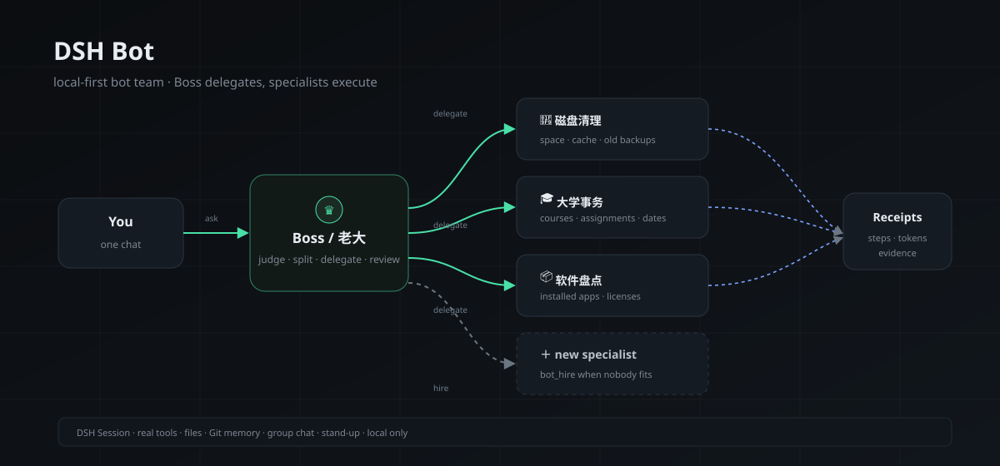

# DSH Bot v6.1.0

**An open-source GrokBot alternative that runs a real bot team on your own Windows machine, inside DeepSeek Harness.**

You talk to one **Boss**. It decides what to do, hires a specialist when nobody fits, delegates real work to bots that each keep their own DSH session, workspace and memory, then reviews the receipts and reports back. Every morning it runs a stand-up where the whole team reports what it did.

## Performance patch (v6.1.0)

- Memory Git history is cached for 5 seconds and invalidated on save/commit/restore.
- `/memory` p50 dropped from about **215 ms** to **2 ms**; the first call still pays the Git cost.
- Reproducible benchmark: `node scripts/bench-api.mjs`; baseline in [`docs/PERFORMANCE.md`](PERFORMANCE.md).
- No new feature surfaces.

## v6 is a polish release

No new feature surfaces. v6 consolidates what already existed: reliability, security, attachment UX, creative output, docs and regression checks.

## Reliability

- Creative tasks now verify once — file exists and page count — then report. They no longer inspect XML/fonts/geometry or hunt LibreOffice indefinitely.
- QQ notifications and QQ remote control remain **default-off**; no automatic polling while disabled.
- Course status reuses returned action results instead of full re-reading every click.

## Attachments

- Files are grouped by type with counts: images, PDF, sheets, code, files.
- Images show thumbnails; the lightbox supports previous/next, counter, zoom, pan, double-click reset and download.
- Attachment cards expose a separate copy-path action; failure cards and thread titles no longer leak raw attachment Markdown.
- Uploads older than 30 days are removed only when unreferenced; referenced files are kept.
- `/file` rejects symlinks and real paths outside uploads; traversal probes return 404.

## UI

- Five themes: dark, warm, ink, Mist, Clay, with a named picker and dual-color previews.
- One accessible Toast component (`role=status`, `aria-live`, Esc/close) and a shared EmptyState for routines and skills.
- Routine empty state offers three starter templates; “保存并运行” creates, runs and opens the task.

## Quality

- CI compiles every Python script with `compileall`, not just three files.
- Version drift across `package.json`, `index.js` and `client.js` now fails checks.
- Real-project validation against `uav-yolo-offboard-tracking`: README attachment extraction and a 4-slide PPT were generated and inspected; details in [`docs/REAL_PROJECT_VALIDATION.md`](REAL_PROJECT_VALIDATION.md).
- DOCX code fences now render as shaded monospace panels instead of plain paragraphs.

## Compatibility

- Existing bots, threads, groups, memories, routines and theme selections are preserved.
- QQ stays off until explicitly enabled in notification settings.
- All API endpoints stay loopback-only; POST requests still require the client marker.

## Install

Download `dsh-bot-6.0.0.zip`, install it in DSH, then reload the plugin. The first install still creates only the Boss; specialists are added on demand.
