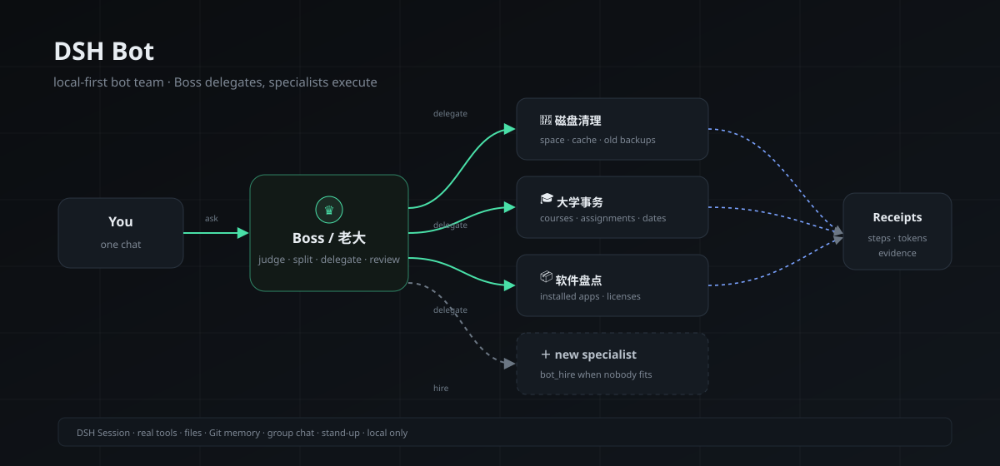

# DSH Bot v6.19.0

**An open-source GrokBot alternative that runs a real bot team on your own Windows machine, inside DeepSeek Harness.**

You talk to one **Boss**. It decides what to do, hires a specialist when nobody fits, delegates real work to bots that each keep their own DSH session, workspace and memory, then reviews the receipts and reports back. Every morning it runs a stand-up where the whole team reports what it did.

## UX (v6.19.0)

- Sidebar drawer breakpoint raised to 1100px so 1024px windows and 125% zoom layouts keep the chat area usable.
- The narrow sidebar backdrop is a real keyboard-focusable close button.
- UX guards cover the new breakpoint and backdrop.

## UX (v6.18.0)

- Toast text no longer captures clicks; only the close button remains interactive, so feedback cannot block pending question/approval controls.
- Pending, approval and checkpoint cards remain in the normal flex flow; added a static guard for Toast click-through.

## UX (v6.17.0)

- Sending restores the live edge immediately; the jump control no longer stays behind after a send.
- Below 760px the Deck has a clickable backdrop for close-by-tap.
- UX guards now cover both paths.

## UX (v6.16.0)

- Toast is positioned above the composer instead of over the input area.
- Corrected the 1500px/1280px breakpoint order so the Deck width at 1280px is actually applied.
- Added static UX guards for jump placement, Toast clearance, scroll reset and breakpoint order.

## UX (v6.15.0)

- Entering a conversation now always starts at the newest message; switching threads resets the scroll lock and jump-button state.
- The scroll is applied both immediately and after the new thread snapshot arrives, so equal-length conversations still land at the bottom.

## UI fix (v6.14.0)

- “回到最新 / Jump to latest” is scoped to the chat view, below the message area and above the composer; it no longer overlaps member tabs.
- Clicking it hides the button immediately and scrolls to the true bottom with a short scroll-lock, so it reliably returns to the newest message.

## Browser extension removed

The ICVE/智慧职教 browser extension and its auto-save/auto-download bridge were removed because opening the browser could crash it.

Removed:

- `browser-extension/icve-assistant` unpacked extension;
- auto-downloaded `dsh-icve-latest.json` snapshots;
- `icve_snapshot.py`, `icve_quiz.py`, `icve_bank.py` and extension-only tests;
- extension-specific prompt/template paths and package entries;
- local ICVE snapshot/question-bank state.

The extension was also removed from the Edge profile. Browsing no longer loads any DSH browser extension.

## Course workflow

智慧职教/刷课 returns to the normal browser UI Automation path:

- `course.py progress` for completed/pending counts;
- `course.py status` for video/PPT/question/next phase;
- `play` / `ppt` / `question` / `answer` / `next` for actions;
- every click is verified; `changed:false` stops the loop.

No local server, clipboard bridge or browser extension is required.

## Kept improvements

- Attachments: grouping, thumbnails, full-window lightbox, zoom/pan/download.
- Five themes, shared Toast/EmptyState, routine templates and save-and-run.
- Morning meeting stale-run reconciliation; watchdog for orphan runs.
- API payload trims, memory history cache, adaptive polling.
- `/file` path/symlink hardening, CI version consistency, DOCX code-block styling.
- QQ notifications and remote control remain **default-off**.

## Install

Download `dsh-bot-6.13.0.zip`, install it in DSH, then reload the plugin. The first install still creates only the Boss; specialists are added on demand.
